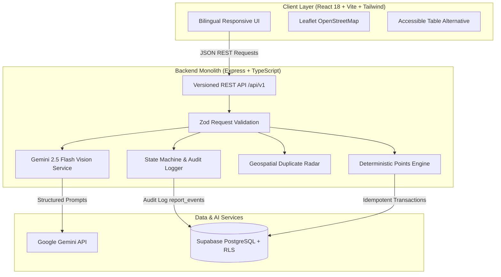

# PatchMyCity 🏙️⚡

> **Report a problem. Rally your neighborhood. Make change visible.**  
> An original civic-tech platform with **City Quest Mode**, built for the **Hack Wave** hackathon.

[](https://www.typescriptlang.org/)
[](https://reactjs.org/)
[](https://vitejs.dev/)
[](https://tailwindcss.com/)
[](https://expressjs.com/)
[](https://ai.google.dev/)
[](https://leafletjs.com/)
[](https://vitest.dev/)
[](https://opensource.org/licenses/MIT)

---

## 📌 Executive Summary

Traditional civic complaint apps fail because citizen reports disappear into a bureaucratic black hole, discouraging public participation.

**PatchMyCity flips the model:**
1. **Gemini Vision** analyzes a photo of a broken street, pothole, or garbage dump, extracting structured physical evidence without making wild assumptions.
2. The citizen reviews the diagnosis, edits any field, and checks nearby duplicates with our **Geospatial Duplicate Radar**.
3. Once verified, the problem doesn't sit in a queue—it unlocks a **City Quest**: a collaborative neighborhood mission where local residents rally as a squad, document progress with photographic evidence, and verify real urban improvement.
4. **Every point and status transition is strictly backend-governed**, idempotent, and backed by an append-only audit trail.

---

## 💡 The Core Innovations

```
 Citizen Takes Photo ──► Gemini 2.5 Flash ──► Citizen Edits & ──► Submitted to
 (EXIF Stripped)        (Visual Evidence)     Checks Duplicates   Open City Map
                                                                        │
                                                                        ▼
 Community Points  ◄──  Squad Submits   ◄──  City Quest ◄──  Issue Verified
 (Idempotent Keys)      After-Photos         Mode Unlocks     by Moderator
```

### 1. 🎯 Signature Innovation: City Quest Mode
Instead of leaving citizens passive, verified civic issues automatically become team missions. Neighbors enlist in a quest squad, follow safety-screened tasks (e.g., *"Photograph asphalt patch from pedestrian sidewalk; never enter traffic"*), submit progress photos, and earn civic points.

### 2. 🛡️ "AI Proposes, the Backend Decides"
Gemini is treated as an advisory micro-service behind server-side **Zod validation**:
- The model suggests category, severity, visible physical evidence, and missing information.
- The model **never** sets database statuses, closes cases, or awards points.
- If no API key is provided, the platform automatically runs in a transparent **Demo Mock Mode** (`source: "mock"`), clearly labeled so judges are never misled.

### 3. 📡 Geospatial Duplicate Radar
Before creating a report, the backend runs a multi-factor candidate screening:
- Radius: **100 meters** (Haversine great-circle calculation)
- Recency: within **30 days**
- Weighted Score: `0.5 × distance + 0.2 × recency + 0.3 × category match`
- Reports with a score $\ge 0.6$ are surfaced, letting the user **"Back Existing Report (+2 pts)"** rather than cluttering municipal dispatch.

### 4. 💎 Deterministic, Idempotent Points Engine
Gamification is protected against abuse and double-submissions:
- Every point award generates an immutable transaction keyed by `{event_type}:{source_id}:{user_id}` enforced by unique database constraints.
- Daily point caps prevent farming.
- Rule-based badges (*First Spark*, *Evidence Hero*, *Quest Squad Member*, *Neighborhood Guardian*) are evaluated on the server.

### 5. 🌐 Bilingual & Fully Accessible
- Full bilingual toggle between **English** and **Hindi (हिंदी Devanagari script)** across the entire UI.
- Built to **WCAG AA** standards: readable contrast, visible focus rings, reduced-motion preferences, and an **accessible tabular list alternative** to the Leaflet map for screen readers and low-bandwidth connections.

---

## 🏛️ System Architecture



---

## 📊 Domain State Machine (Section 5.1 Rules)

Every lifecycle change writes an append-only audit record into `report_events`. Illegal transitions are rejected by the backend:

| Current Status | Permitted Next Statuses | Transition Requirements |
|---|---|---|
| `submitted` | `under_review`, `rejected` | Citizen files report with photo |
| `under_review` | `verified`, `rejected` | Moderator verifies coordinates & visual evidence (+10 pts to reporter) |
| `verified` | `in_progress`, `rejected` | Unlocks City Quest; municipal crew dispatched |
| `in_progress` | `awaiting_resolution_verification` | Repair work performed; pending sign-off |
| `awaiting_resolution_verification` | `resolved`, `reopened` | Requires **$\ge 1$ accepted evidence photo** AND (**Admin sign-off** OR **3 distinct community confirmations**) |
| `resolved` | `reopened` | Disputed evidence or recurring issue |
| `reopened` | `under_review` | Re-queued for municipal inspection |

---

## 📡 REST API Reference (`/api/v1`)

| Method | Endpoint | Description | Auth / Role |
|---|---|---|---|
| `GET` | `/health` | Health check, server uptime, and Gemini connection status | Public |
| `POST` | `/ai/analyze-image` | Gemini 2.5 Flash Vision structured diagnostics | Public |
| `POST` | `/ai/translate-report` | Bilingual English <-> Hindi faithful translation | Public |
| `POST` | `/ai/generate-quest` | AI-assisted City Quest draft generation | Public |
| `GET` | `/reports` | List all civic reports (filters: `status`, `category`, `is_demo`) | Public |
| `POST` | `/reports` | Submit a new civic issue report with Zod validation | Public |
| `POST` | `/reports/check-duplicates` | Multi-factor geospatial duplicate candidate search | Public |
| `GET` | `/reports/:id` | Get report details, evidence gallery, and audit timeline | Public |
| `POST` | `/reports/:id/support` | Back an existing report (+2 pts, capped at 3/day) | Citizen |
| `POST` | `/reports/:id/evidence` | Submit photographic repair evidence (+15 pts) | Citizen |
| `POST` | `/reports/:id/transition` | Execute state machine lifecycle transition with audit log | Moderator / Admin |
| `GET` | `/quests` | List active City Quests and squad progress | Public |
| `GET` | `/quests/:id` | Get quest objectives, safety checklist, and squad roster | Public |
| `POST` | `/quests/:id/join` | Enlist in a neighborhood quest squad | Citizen |
| `GET` | `/dashboard/impact` | Real aggregated ledger statistics (separating live vs demo) | Public |
| `GET` | `/leaderboard` | Citizen reputation rankings, badges, and points ledger | Public |
| `GET` | `/badges` | List all available badge criteria and translations | Public |

---

## 🚀 Quick Start & Installation

### 1. Prerequisites
- **Node.js**: v18.0.0 or higher
- **npm**: v9.0.0 or higher

### 2. Clone & Install
```bash
git clone https://github.com/Bharat-012/Hack-Wave.git
cd Hack-Wave

# Install root workspaces (server + client)
npm install
```

### 3. Environment Configuration
Create a `.env` file in the root directory:
```bash
cp .env.example .env
```
Configure your Gemini API Key in `.env`:
```env
PORT=5000
NODE_ENV=development
CLIENT_URL=http://localhost:5173
GEMINI_API_KEY=your_gemini_api_key_here
GEMINI_MODEL=gemini-2.5-flash
```
> **Note on Demo Mode:** If `GEMINI_API_KEY` is left blank, PatchMyCity automatically boots in transparent **Demo Mock Mode** with labeled mock analyses (`source: "mock"`).

### 4. Run Locally
Run both client and server concurrently:
```bash
npm run dev
```
- **Web Application:** [http://localhost:5173](http://localhost:5173)
- **API Health Check:** [http://localhost:5000/api/v1/health](http://localhost:5000/api/v1/health)

### 5. Run Automated Tests
```bash
# Run server Vitest suite (state machine, points, duplicate radar, API integration)
npm test --workspace=server

# Run TypeScript typechecks
npm run typecheck
```

---

## 🧪 Verified Test Suite Summary

All 14 tests run and pass without mock fabrication:
```
✓ src/services/pointsService.test.ts (2 tests)
  - awards points once and rejects duplicate calls with same idempotency key
  - enforces daily support cap of 3 supports per day
✓ src/services/stateMachine.test.ts (3 tests)
  - allows valid transition from submitted to under_review
  - rejects illegal transition directly from submitted to in_progress
  - prevents regular citizen from verifying a report
✓ src/services/duplicateService.test.ts (3 tests)
  - correctly calculates Haversine distance in meters
  - suggests duplicate when distance <= 100m, category matches, and report is recent
  - ignores candidate if distance exceeds 100 meters
✓ src/app.test.ts (6 tests)
  - GET /api/v1/health returns status ok and gemini status
  - GET /api/v1/reports returns seeded demo reports
  - POST /api/v1/reports rejects invalid schema with 400
  - POST /api/v1/reports successfully creates a live report
  - POST /api/v1/ai/analyze-image returns structured analysis
  - GET /api/v1/dashboard/impact separates live and demo metrics
```

---

## 📁 Repository Layout

```
.
├── AGENTS.md               # Engineering directives & code standards
├── README.md               # Master project documentation
├── .env.example            # Environment configuration template
├── package.json            # NPM workspaces configuration
├── docs/                   # Project memory & architectural records
│   ├── ARCHITECTURE.md     # Component diagrams & data flows
│   ├── CHANGELOG.md        # Release version history
│   ├── DECISIONS.md        # Architecture Decision Records (ADRs)
│   ├── DEMO_SCRIPT.md      # 3–5 minute judge walkthrough guide
│   ├── DEPENDENCY_MAP.md   # Contracts, routes, and DB dependencies
│   ├── HANDOFF.md          # Current project state & handover notes
│   ├── PROJECT_CONTEXT.md  # Live MoSCoW implementation checklist
│   └── REFERENCE_ANALYSIS.md# Evaluation of 4 reference civic repos
├── server/                 # Express + TypeScript backend API
│   ├── src/
│   │   ├── config/         # Constants, domain rules, env validation
│   │   ├── controllers/    # Route handlers (reports, quests, AI, dashboard)
│   │   ├── routes/         # Express router (/api/v1)
│   │   ├── services/       # Gemini, state machine, points, duplicate radar
│   │   ├── types/          # TypeScript domain models
│   │   ├── app.ts          # Express app configuration & middlewares
│   │   └── server.ts       # Server entrypoint & graceful shutdown
├── client/                 # React 18 + Vite frontend
│   ├── src/
│   │   ├── api/            # Typed backend API client
│   │   ├── components/     # Navbar, Footer, CityMap, ReportListView, StatusChip
│   │   ├── i18n/           # English & Hindi translation dictionaries
│   │   ├── pages/          # Home, Explore, Report, Detail, Quests, Dashboard, Admin
│   │   ├── types/          # Frontend data models
│   │   ├── App.tsx         # Route router
│   │   └── index.css       # Tailwind CSS & design tokens
└── supabase/
    └── migrations/         # PostgreSQL schema DDL with RLS and seed data
```

---

## ⚠️ Honest Limitations & Roadmap

1. **Reverse Geocoding:** Address resolution uses OpenStreetMap Nominatim with client-side debounce. In high-traffic deployments, a dedicated enterprise geocoding proxy is recommended.
2. **Production Media Storage:** Local development handles preview buffers; the provided Supabase schema contains the DDL and RLS policies for private buckets and signed delivery URLs.
3. **Future Roadmap:** Push notifications for watch zones, progressive web app (PWA) offline report drafts, and CLIP-based image embedding similarity as a secondary duplicate check.

---

## 📄 License

Original work created for the **Hack Wave** Hackathon. Licensed under the **MIT License**.
