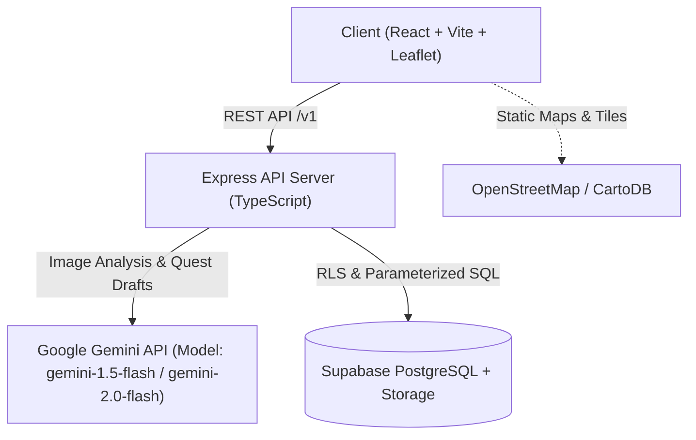
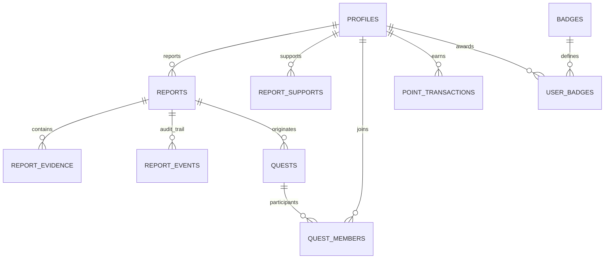

# ARCHITECTURE: PatchMyCity

## 1. System Overview

PatchMyCity is designed as a secure, modular monolith with a React/Vite Single Page Application frontend, an Express/TypeScript backend API, and a Supabase PostgreSQL database.

---

## 2. Component Architecture

### Client (`client/`)
- **UI Components:** Minimal, high-contrast, WCAG AA compliant design system with Warm Off-White (`#FBFBF9`), Forest Green (`#1E3A2F`), and Lime/Amber accents (`#10B981`, `#F59E0B`).
- **Map & Geospatial:** Leaflet with custom SVG markers, clustered pins, and accessible list toggle.
- **Localization:** i18next supporting English (`en`) and Hindi (`hi`).
- **Client Security:** Zero environment secrets in client bundle; image downscaling and EXIF stripping before upload.

### Server (`server/`)
- **API Routing (`/api/v1`):**
  - `/ai`: Image analysis, report translation, quest generation.
  - `/reports`: CRUD, status transitions, duplicate checks, evidence submission, community support.
  - `/quests`: Quest listings, squad join, contribution submission.
  - `/leaderboard`: Weekly and all-time reputation rankings.
  - `/dashboard`: Aggregated metrics distinguishing demo data from live data.
- **Middleware:** Helmet, CORS allowlist, rate limiting, Zod request body validation, centralized error handling.
- **Services:**
  - `gemini.ts`: Safe wrapper with structured schemas, retry logic, prompt-injection sanitization, and labeled mock fallback.
  - `duplicateService.ts`: Weighted scoring (distance 0.5, category 0.3, time 0.2) with 100m threshold.
  - `pointsService.ts`: Idempotent point transaction processor with daily caps.
  - `stateMachine.ts`: Validates report state transitions and writes audit events.

---

## 3. Database Schema Overview

### Key Tables
1. **`profiles`**: `id`, `username`, `display_name`, `avatar_url`, `role` (citizen/moderator/admin), `points_total`, `is_demo`.
2. **`reports`**: `id`, `reporter_id`, `title`, `description`, `category`, `severity`, `status`, `latitude`, `longitude`, `address`, `image_url`, `ai_analysis`, `is_demo`, `created_at`, `updated_at`.
3. **`report_evidence`**: `id`, `report_id`, `user_id`, `image_url`, `notes`, `status` (pending/accepted/rejected), `is_demo`.
4. **`report_events`**: `id`, `report_id`, `actor_id`, `from_status`, `to_status`, `reason`, `created_at`.
5. **`report_supports`**: `id`, `report_id`, `user_id`, `created_at` (Unique: `[report_id, user_id]`).
6. **`quests`**: `id`, `report_id`, `title`, `objective`, `suggested_actions`, `status`, `target_contributors`, `points_reward`, `is_demo`.
7. **`quest_members`**: `id`, `quest_id`, `user_id`, `joined_at` (Unique: `[quest_id, user_id]`).
8. **`point_transactions`**: `id`, `user_id`, `points`, `event_type`, `source_id`, `idempotency_key` (UNIQUE), `created_at`.
9. **`badges`** & **`user_badges`**: Server-evaluated awards based on verified community contributions.
10. **`moderation_flags`**: Citizen dispute and spam reporting system.
