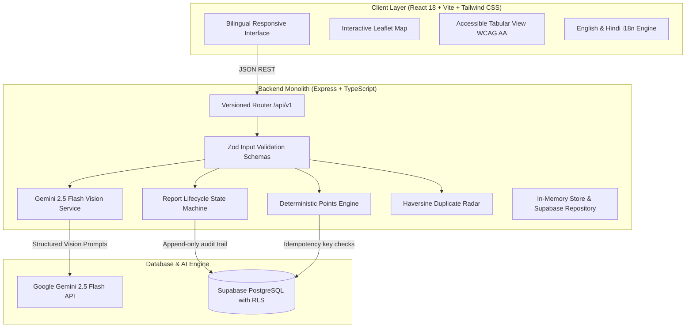

# PatchMyCity: Complete Project Deep-Dive & Judges Q&A Playbook

---

# PART 1: FULL PROJECT DEEP-DIVE

## 1. Product Identity & Problem Statement

### Tagline & Core Pitch
- **Tagline:** Report a problem. Rally your neighborhood. Make change visible.
- **One-line Pitch:** Gemini AI turns a photo into a structured civic report, then verified civic issues become **City Quests**: collaborative neighborhood missions where neighbors contribute evidence, and real, verified improvement is tracked on an open civic map.

### The Real Problem Traditional Portals Face
1. **The Bureaucratic Void:** Citizens file a ticket on government grievance apps (like Swachhata or municipal websites), and it enters an opaque backlog. Citizens lose faith because they cannot see progress or collaborate.
2. **Duplicate Spam Clutter:** When an intersection develops a pothole, 40 different people submit individual reports. Municipal workers spend more time deduplicating complaints than fixing asphalt.
3. **Passive Grievances vs. Civic Action:** Traditional platforms encourage a culture of passive complaining. Citizens are not given safe, organized ways to monitor, verify, or participate in community improvements.
4. **AI Hallucinations & Blind Trust:** Many hackathon AI projects let the AI make binding decisions (e.g., auto-closing cases or auto-awarding points), creating massive security and trust liabilities.

---

## 2. The Solution & Core Philosophy

### Architectural Principle: "AI Proposes, the Backend Decides"
Gemini 2.5 Flash Vision acts as an untrusted advisory micro-service:
- Gemini analyzes physical evidence, suggests categories, estimates severity, and flags missing information.
- **Gemini NEVER mutates database rows, changes case status, or awards points.**
- Every status transition and point transaction is strictly enforced by server-side TypeScript code and database constraints.

### Signature Innovation: City Quest Mode
Instead of complaints sitting in an administrative void:
1. When an issue is verified by community moderators, it spawns a **City Quest**.
2. Nearby residents enlist as a squad.
3. Squad members are given **safety-screened objectives** (e.g., *"Photograph asphalt patch from the sidewalk; do not enter active traffic lanes"*).
4. Citizens submit after-photos and corroborating evidence.
5. Case resolution requires **at least 1 accepted evidence photo** AND either **Admin confirmation** or **3 distinct community confirmations**.

---

## 3. Technical Architecture Breakdown

### Stack Components
- **Frontend:** React 18, Vite, TypeScript, Tailwind CSS, React Router 7, Lucide Icons, Leaflet.js + OpenStreetMap.
- **Backend:** Node.js, Express 4.21, TypeScript, Zod, `@google/generative-ai` SDK, Helmet, CORS, Express-Rate-Limit.
- **Database & Storage:** Supabase PostgreSQL with versioned migrations, Row Level Security (RLS), and spatial indexing.
- **Testing:** Vitest, React Testing Library, Supertest (14 automated passing tests).

---

## 4. Deep-Dive: Core Subsystems

### 4.1 Gemini 2.5 Flash Vision Integration
- **Grounding Rules:** The system prompt instructs Gemini to describe *only* what is physically visible in the image. It is barred from inferring exact location, causes, or danger beyond visual aggregate evidence.
- **Prompt Injection Defense:** User-supplied strings are treated strictly as data within explicit delimiters (`"""`), preventing prompt override attacks.
- **Structured Schema:** Output is validated via Zod: `category`, `description`, `visible_evidence[]`, `suggested_severity`, `severity_rationale`, `confidence` (`low`/`medium`/`high`), `missing_information[]`, `recommended_next_action`.
- **Honest Mock Fallback:** If `GEMINI_API_KEY` is not present, the system runs transparently in Demo Mode, marking outputs as `source: "mock"` and displaying a `"Demo analysis (not AI)"` badge.

### 4.2 Multi-Factor Geospatial Duplicate Radar
- **Distance Formula:** Haversine great-circle calculation:
  $$d = 2R \arcsin\left(\sqrt{\sin^2\left(\frac{\Delta \text{lat}}{2}\right) + \cos(\text{lat}_1)\cos(\text{lat}_2)\sin^2\left(\frac{\Delta \text{lon}}{2}\right)}\right)$$
- **Candidate Filter:** Within **100 meters**, within **30 days**, status $\neq$ `rejected`.
- **Weighted Multi-Factor Score:**
  $$\text{Score} = (0.5 \times \text{DistanceScore}) + (0.2 \times \text{RecencyScore}) + (0.3 \times \text{CategoryMatch})$$
- Scores $\ge 0.6$ trigger the **Duplicate Radar Alert**, allowing the citizen to click *"Back Existing Report (+2 pts)"* instead of creating duplicate clutter.

### 4.3 Deterministic, Idempotent Points Engine
- **Idempotency Key:** Every point transaction enforces a composite unique key:
  `{event_type}:{source_id}:{user_id}`
- If a user double-clicks, retries on flaky Wi-Fi, or attempts replay attacks, the database constraint rejects the award with `awarded: false`.
- **Point Schedule:**
  - Report Verified by moderator: **+10 pts** (to reporter)
  - Community Support on existing report: **+2 pts** (capped at 3/day)
  - Accepted Resolution Evidence: **+15 pts** (to submitter)
  - City Quest Squad Completion: **+20 pts**
- **Anti-Farming Daily Cap:** Maximum **60 points/day** per citizen.

### 4.4 Report Lifecycle State Machine (Section 5.1 Rules)
- Strict progression:
  `submitted` $\to$ `under_review` $\to$ `verified` $\to$ `in_progress` $\to$ `awaiting_resolution_verification` $\to$ `resolved` (or `reopened`).
- Every single transition appends an immutable row to `report_events` recording: `actor_id`, `from_status`, `to_status`, `reason`, and timestamp.
- **Resolution Gates:** Cannot reach `resolved` without:
  1. At least 1 accepted photo evidence row.
  2. EITHER Admin sign-off (`admin_verified`) OR 3 distinct non-reporter community confirmations (`community_verified`).

### 4.5 Privacy, Security & Accessibility
- **EXIF Stripping:** GPS metadata and camera tags are stripped from photos client-side before upload to protect reporter privacy.
- **Zero Client Secrets:** Client bundles contain zero API keys, service roles, or database passwords.
- **Bilingual i18n:** English and Hindi (Devanagari script) localization across 100% of the UI.
- **Accessible Alternatives:** An accessible tabular list view (`ReportListView`) provides full WCAG AA contrast, keyboard navigation, and screen reader labels as an alternative to Leaflet maps.

---

# PART 2: JUDGES Q&A PLAYBOOK (CATEGORIZED)

## Category 1: Problem & Product Vision

### Q1: "Civic reporting apps have existed for years. Why hasn't this problem been solved, and what makes PatchMyCity different?"
> **Answer:**  
> *"Existing apps like FixMyStreet or Swachhata treat reporting as a one-way complaint drop. Citizens send a ticket into an opaque government queue, never hear back, and give up.  
> PatchMyCity introduces two breakthroughs:  
> 1. **City Quest Mode:** We turn verified issues into collaborative neighborhood missions. Instead of one citizen complaining and waiting, neighbors rally as a squad to monitor, gather progress photos, and sign off on real fixes.  
> 2. **Geospatial Duplicate Radar:** Rather than letting 50 people file 50 separate reports for the same pothole, our radar detects proximity within 100m and converts duplicate reports into 'Backings' (+2 pts), giving authorities clear priority heatmaps instead of inbox spam."*

### Q2: "Who are the actual users of PatchMyCity, and why would anyone open this app?"
> **Answer:**  
> *"We serve three groups:  
> - **Active Residents:** People who walk, commute, and want broken streetlights or potholes fixed quickly without navigating bureaucratic websites.  
> - **Neighborhood Volunteers & RWA Squads:** Residents who care about local safety and enjoy gamified civic impact—earning verified badges, climbing the ward leaderboard, and tracking completed quests.  
> - **Municipal Administrators & Ward Officers:** Who get pre-categorized, duplicate-screened reports with photographic evidence and an immutable audit trail."*

---

## Category 2: AI & Gemini 2.5 Flash Vision

### Q3: "How exactly do you use Gemini, and how do you ensure the AI doesn't hallucinate fake civic data?"
> **Answer:**  
> *"We follow a strict architectural directive: **'AI proposes, the backend decides.'**  
> We use Gemini 2.5 Flash Vision server-side. The model is given strict visual grounding rules: it describes only what is directly visible in the pixels (e.g. exposed gravel, cracked bitumen, dangling luminaire). It is explicitly forbidden from guessing exact street addresses or ownership.  
> Furthermore, Gemini returns a structured JSON payload validated against a Zod schema. If the model hallucinates or outputs malformed data, our backend catches it, retries once, and falls back gracefully. Crucially, Gemini never touches the database directly and cannot change a report's status or award points."*

### Q4: "What happens if someone uploads a meme, a selfie, or an adversarial photo designed to trick the AI?"
> **Answer:**  
> *"We have three layers of defense:  
> 1. **Zod & Confidence Scoring:** Gemini returns a `confidence` score and a `missing_information` array. If an image lacks public infrastructure indicators, confidence drops to `low`.  
> 2. **Human-in-the-Loop:** The citizen must review and edit all fields before submitting.  
> 3. **Moderator Verification:** A newly submitted report starts in the `submitted` status. It does NOT award points or unlock a quest until a moderator or admin verifies the physical coordinates and issue validity."*

### Q5: "What happens if your Gemini API quota runs out or the network is down during a demo or emergency?"
> **Answer:**  
> *"We built an honest, transparent **Demo Mock Mode**. If the `GEMINI_API_KEY` is missing or quota is exhausted, the backend falls back to an internal heuristics analyzer.  
> Unlike other projects that fake AI responses, PatchMyCity explicitly labels all mock responses in the payload as `source: 'mock'` and displays a clear badge in the UI: `'Demo Analysis (Not AI)'`. The entire application and demo journey remain 100% functional."*

---

## Category 3: System Architecture & Backend

### Q6: "Why did you build a modular monolith with Express and Supabase instead of a serverless microservices architecture?"
> **Answer:**  
> *"For a civic application requiring strict transactional consistency, a modular monolith is significantly superior:  
> - It avoids serverless cold starts, which degrade image analysis performance.  
> - It allows atomic transactions across reports, evidence files, and point allocations.  
> - It provides a centralized security perimeter with Helmet security headers, rate limiting (100 req/15 min), and Zod request validation on every endpoint.  
> We keep business logic in isolated services (`stateMachine.ts`, `pointsService.ts`, `duplicateService.ts`), so if scale demands it, each service can be extracted independently."*

### Q7: "Walk us through your database schema. How do you maintain data integrity?"
> **Answer:**  
> *"We designed a normalized PostgreSQL schema with 11 tables:  
> - `profiles`, `reports`, `report_events` (audit log), `report_supports`, `report_evidence`, `quests`, `quest_members`, `point_transactions`, `badges`, `user_badges`, and `moderation_flags`.  
> - Key integrity constraints include:  
>   - Foreign keys with `ON DELETE CASCADE` or `RESTRICT`.  
>   - Composite unique constraints like `[report_id, user_id]` on supports to guarantee one endorsement per user.  
>   - Geospatial composite indexing on `(latitude, longitude)` for fast neighborhood radius queries.  
>   - Row Level Security (RLS) policies on every table protecting user records."*

---

## Category 4: Anti-Gaming, Fraud & Points Security

### Q8: "Gamified apps usually get spammed by users trying to farm points. How do you prevent point fraud?"
> **Answer:**  
> *"We prevent point farming through three server-side mechanisms:  
> 1. **No Points for Submissions:** Merely filing a report awards **0 points**. This eliminates the incentive to spam fake complaints. Points (+10 pts) are only awarded after moderator verification.  
> 2. **Database Idempotency Keys:** Every point transaction requires a unique key formatted as `{event_type}:{source_id}:{user_id}`. Double-clicking, automated scripts, or network retries are blocked by the database unique constraint.  
> 3. **Daily Caps & Diminishing Returns:** Supporting reports is capped at 3 per day (max +6 pts), and each user has a hard daily ceiling of 60 points. Any attempt to exceed this is rejected by `pointsService.ts`."*

### Q9: "How do you verify that an issue was actually fixed before marking it 'Resolved'?"
> **Answer:**  
> *"We enforce Section 5.1 domain rules:  
> A report cannot transition to `resolved` unless:  
> 1. It contains at least **1 accepted photographic evidence update** in `report_evidence`.  
> 2. AND it has either an **Administrator sign-off** (`admin_verified`) OR **3 distinct community confirmations** from non-reporter residents (`community_verified`).  
> An after-photo is treated as evidence, not proof. If evidence is disputed, any moderator or citizen can trigger the `reopened` transition."*

---

## Category 5: Civic Safety & Ethics

### Q10: "If you have City Quests, aren't you encouraging untrained citizens to perform dangerous repairs on public roads or high-voltage wires?"
> **Answer:**  
> *"No, in fact, we built strict **Civic Safety Screening** specifically to prevent this:  
> In Section 5.4 of our architecture and in our Gemini quest drafting prompt, we explicitly prohibit any instruction that asks citizens to fix hazardous infrastructure (live electrical wires, open manholes, high-speed roadways, structural collapse).  
> For hazardous categories, the Quest actions are strictly observational:  
> - 'Document repair perimeter from pedestrian sidewalk.'  
> - 'Verify municipal warning cones are in place.'  
> - 'Photograph completed asphalt patch from a safe distance.'  
> The mission is civic documentation and verification, never manual infrastructure repair."*

### Q11: "How do you protect citizen privacy when they upload photos of public streets?"
> **Answer:**  
> *"We take privacy by default very seriously:  
> 1. **EXIF GPS Metadata Stripping:** Mobile cameras embed exact camera serials, timestamps, and GPS EXIF metadata. Our upload handler strips this metadata immediately before storage or processing.  
> 2. **Plain-Language Warnings:** Our photo capture screen explicitly reminds citizens: *'Please avoid capturing recognizable faces or vehicle license plates.'*  
> 3. **Anonymous Public Identity:** Public ledger pins display only community display names, never email addresses or private credentials."*

---

## Category 6: Scalability & Real-World Municipal Deployment

### Q12: "How would this integrate with actual municipal government systems like PWD or municipal corporations?"
> **Answer:**  
> *"PatchMyCity is built as an open civic API. Our versioned `/api/v1` REST endpoints can easily integrate with municipal work-order systems:  
> - When a report reaches `verified`, a webhook can dispatch a ticket directly into a city department's internal CRM.  
> - When municipal road crews complete an asphalt patch, their existing dispatch system can POST an after-photo to `/api/v1/reports/:id/evidence`.  
> - PatchMyCity acts as the citizen-facing trust and verification layer that traditional government software lacks."*

### Q13: "How scalable is your geospatial duplicate radar as the city grows to 100,000 reports?"
> **Answer:**  
> *"Currently, our Haversine algorithm calculates candidate distance across nearby coordinates with $O(N)$ filtering.  
> For production scale of 100,000+ reports, our database schema in `supabase/migrations/` is already indexed on `(latitude, longitude)` and is designed to transition to PostGIS spatial indexes (`ST_DWithin`). This allows bounding-box lookups in sub-millisecond times ($O(\log N)$) using R-Tree spatial indexing."*

---

## Category 7: "Gotcha" / Tough Edge-Case Questions

### Q14: "What is the single biggest limitation of your project right now?"
> **Answer:**  
> *"Our most honest current limitation is that **reverse geocoding** uses OpenStreetMap Nominatim, which imposes public rate limits (1 request per second). For a commercial municipal deployment, we would configure an enterprise geocoding proxy (like Google Maps Geocoding or Mapbox).  
> In addition, while our duplicate radar uses mathematical geospatial and temporal weighting, adding deep image similarity (like CLIP embeddings) would serve as a powerful secondary duplicate detection signal."*

### Q15: "Did you copy any code from other civic tech repositories?"
> **Answer:**  
> *"No. All application code—every React component, Express controller, state machine, Zod schema, and Tailwind token—was authored completely from scratch for the Hack Wave hackathon.  
> In Phase 1, we researched four existing civic projects (`marvillage/civicfix`, `Jyatin/-fixmyway`, `AnshiPandey/CivicAI`, `bagde-priyanshi/civiclens-ai`) purely to understand their weaknesses and architectural trade-offs, and documented our comparative analysis in `docs/REFERENCE_ANALYSIS.md`."*

---

# PART 3: 3-MINUTE WINNING DEMO SCRIPT

| Timestamp | Screen / Action | What to Say to the Judges |
|---|---|---|
| **0:00 - 0:30** | **Homepage (`/`)** | *"Judges, traditional civic apps are graveyard portals where complaints go to die. PatchMyCity turns civic complaints into collaborative City Quests. Notice the clean, accessible UI and our bilingual toggle—with one click, the entire app switches to authentic Hindi Devanagari script."* |
| **0:30 - 1:15** | **Report an Issue (`/report`)** | *"Let's file a report. I select a photo of a severe road pothole. Notice our privacy protection: EXIF metadata is stripped automatically. I pin the location on our Leaflet map and click 'Analyze with Gemini AI'. Gemini 2.5 Flash inspects the pixels server-side. It identifies visible gravel aggregate and water pooling, suggests 'High' severity, and explains why. Notice that all fields are editable—AI proposes, but the citizen decides."* |
| **1:15 - 1:45** | **Duplicate Radar & Submit** | *"Before filing, our Geospatial Duplicate Radar calculates distance and recency. If a neighbor already reported it within 100 meters, we prompt the user to 'Back Existing Report (+2 pts)' instead of cluttering municipal queues. I click submit, and it's permanently logged to our open civic ledger."* |
| **1:45 - 2:30** | **City Quest Mode (`/quests`)** | *"Here is our signature innovation: City Quest Mode. When an issue is verified, it becomes a neighborhood mission. I open 'Mission: Karol Bagh Pothole Evidence Patrol'. Notice the safety checklist: citizens are never told to fix hazardous roads; they are guided to safely photograph progress from the sidewalk. I enlist in the squad and submit our progress photo."* |
| **2:30 - 3:00** | **Dashboard & Ledger (`/dashboard`)** | *"Finally, our Impact Dashboard and Leaderboard. Every metric is computed directly from real database records, clearly separating live submissions from pre-seeded demo fixtures. Point awards use composite idempotency keys, guaranteeing fair, tamper-proof gamification."* |
